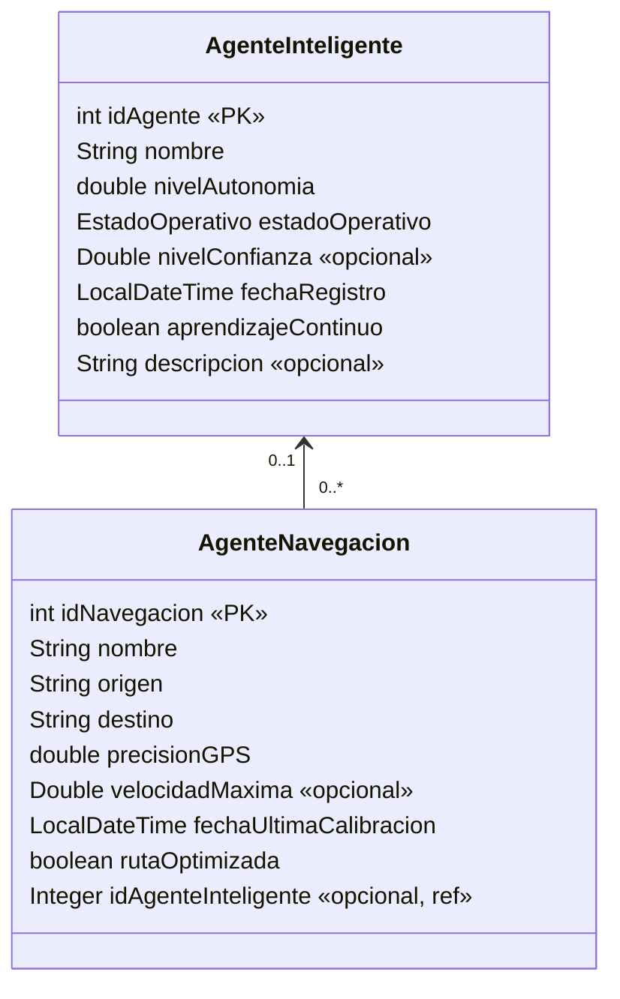

# Sistema de Agentes Inteligentes — Tercer prototipo 2026B

Universidad de Ibagué · Versión 3.0.0

**Hecho por:** Stephany Trujillo Murillo

Aplicación web distribuida: un **servidor Java (Spring Boot + GraphQL)** que guarda la información en
**MongoDB (base de datos NO relacional, dos colecciones)** y **dos clientes en lenguajes diferentes al
servidor y entre sí: uno de escritorio y uno web**. Ambos clientes implementan TODOS los casos de uso de
LAS DOS clases.

| Componente | Tecnología | Tipo | Puerto |
|---|---|---|---|
| `Servidor/ServidorAgentes` | Java 17 · Spring Boot 3 · Spring for GraphQL · Spring Data MongoDB | Servidor | 8081 |
| `Cliente-Escritorio-Python` | Python 3 · Tkinter · requests | **Escritorio** | — |
| `Cliente-Web-React` | JavaScript · React 18 · Vite | **Web** | 5173 |
| MongoDB | `agentes_inteligentes_db` | Persistencia | 27017 |

## Qué cambió respecto al segundo proyecto

| Observación / requisito | Antes | Ahora |
|---|---|---|
| Un cliente de escritorio y otro web | Flask (web) y React (web) | **Tkinter (escritorio)** y React (web) |
| Base de datos NO relacional, prohibido usar listas | `List` en memoria | **MongoDB**, colecciones `agentes_inteligentes` y `agentes_navegacion` |
| Cada caso de uso se califica en LAS DOS tecnologías | Cada cliente manejaba una sola clase | Cada cliente maneja **las dos clases** completas |
| Revisar queries con parámetros | Criterios combinados y consultas armadas con texto | Todas las operaciones usan **variables GraphQL** (`$id`, `$nombre`, `$estado`, `$destino`); la consulta de un solo objeto es por **un** parámetro (ID o nombre único) |
| Listar B debe mostrar sus atributos + 2 de A | No | Consulta personalizada con `$lookup`: navegación + **nombre y estado** del agente inteligente |
| Relación 0..1 — 0..* | El maestro tenía `List<AgenteNavegacion>` | La colección B referencia a A con `idAgenteInteligente` (opcional) |

## Modelo



| Atributo | Tipo | Obligatorio | Validación |
|---|---|---|---|
| idAgente / idNavegacion | int | Sí (llave primaria) | Entero positivo, no repetido |
| nombre | String | Sí | 3–50 caracteres, letras/números/espacio/`.`/`-`/`_`, único (sin distinguir mayúsculas) |
| nivelAutonomia / precisionGPS | double | Sí | 0 a 100 |
| estadoOperativo | enum | Sí | ACTIVO, INACTIVO o MANTENIMIENTO |
| nivelConfianza | Double | No | 0 a 100 |
| velocidadMaxima | Double | No | Mayor que 0 y hasta 500 km/h |
| fechaRegistro / fechaUltimaCalibracion | LocalDateTime | Sí | No puede ser futura |
| aprendizajeContinuo / rutaOptimizada | boolean | Sí | — |
| descripcion | String | No | Máximo 200 caracteres |
| origen / destino | String | Sí | 2–60 caracteres; origen ≠ destino |
| idAgenteInteligente | Integer | No | Si se envía, el agente inteligente debe existir |

Las validaciones se hacen en los clientes (para avisar antes de enviar) y **también en el servidor**
(Bean Validation en los `input` + reglas de negocio en los servicios).

Al eliminar un agente inteligente, sus agentes de navegación **no se borran**: quedan sin agente asignado
(respeta la multiplicidad 0..1 del diagrama). El usuario ve ese aviso antes de confirmar.

## Consultas personalizadas (escritas por el equipo)

| Consulta GraphQL | Implementación en MongoDB | Qué muestra |
|---|---|---|
| `agentesInteligentesResumen(estado, pagina, tamano)` | `@Aggregation` paginada con `$lookup` a `agentes_navegacion` | Todos los datos del **maestro + 2 datos del detalle** (cantidad de navegaciones y precisión GPS promedio). Filtro por estado |
| `navegacionesConAgente(destino, pagina, tamano)` | `@Aggregation` paginada con `$match` regex + `$lookup` | Todos los datos del **detalle + 2 del maestro** (nombre y estado del agente). Filtro por destino |
| `navegacionesPorAgente(idAgente, pagina, tamano)` | `@Aggregation` paginada con `$match` + `$lookup` | Igual que la anterior, filtrando por agente inteligente |
| `agentesPorEstadoYAutonomia(estado, autonomiaMinima, pagina, tamano)` | `@Query` con dos parámetros, paginada | Agentes de un estado con autonomía mínima |

Ejemplos listos para GraphiQL en `Servidor/ServidorAgentes/consultas-ejemplo.graphql`.

## Operaciones (las dos clases, en los dos clientes)

| Caso de uso | Agente inteligente | Agente de navegación |
|---|---|---|
| Adicionar | `crearAgenteInteligente` | `crearAgenteNavegacion` |
| Consultar un objeto (por ID o por nombre) | `agenteInteligentePorId` / `agenteInteligentePorNombre` | `agenteNavegacionPorId` / `agenteNavegacionPorNombre` |
| Listar en grilla paginada + filtro | `agentesInteligentesResumen(estado, pagina, tamano)` | `navegacionesConAgente(destino, ...)` / `navegacionesPorAgente(idAgente, ...)` |
| Actualizar (búsqueda previa, muestra todo) | `actualizarAgenteInteligente` | `actualizarAgenteNavegacion` |
| Eliminar (búsqueda previa, muestra todo y confirma) | `eliminarAgenteInteligente` | `eliminarAgenteNavegacion` |

## Estructura

```
Servidor/ServidorAgentes/src/main/java/com/unibague/agentes/
├── model/        AgenteInteligente, AgenteNavegacion, EstadoOperativo   (clases estructurales, Builder)
├── dto/          Inputs con Bean Validation + AgenteResumen, NavegacionConAgente (resultados de $lookup)
├── repository/   Repositorios Spring Data MongoDB con @Query y @Aggregation
├── servicios/    Interfaces + implementaciones (reglas de negocio)
├── controller/   Controladores GraphQL (@QueryMapping / @MutationMapping)
├── config/       Escalar DateTime, datos iniciales
└── excepciones/  Excepciones propias + ManejadorErroresGraphQL (mensajes claros al cliente)

Cliente-Escritorio-Python/
├── modelo/       AgenteInteligente, AgenteNavegacion, campos, validador, formato
├── servicios/    ClienteGraphQL (Singleton), Notificador (Observer) + un servicio por clase
└── vistas/       ventana_principal, acerca_de, casos_base, componentes
    ├── agente_inteligente/   una ventana (Toplevel) por caso de uso
    └── agente_navegacion/    una ventana (Toplevel) por caso de uso

Cliente-Web-React/src/
├── modelo/       AgenteInteligente, AgenteNavegacion, campos, validador, formato
├── servicios/    clienteGraphQL (Singleton), notificador (Observer) + un servicio por clase
├── componentes/  MenuPrincipal, Ventana, Formulario, Ficha, Grilla, Buscador, Aviso, AcercaDe
└── vistas/       Inicio + una vista por caso de uso (Adicionar, Consultar, Listar, Actualizar, Eliminar)
```

## Rendimiento con miles de registros

En las entregas anteriores el listado traía **todos** los registros de una vez. Con miles de agentes eso
significa: unir cada uno con la otra colección, enviar todo por la red y dibujar miles de filas. Ahora:

1. **Paginación en el servidor.** Cada listado recibe `pagina` (desde 0) y `tamano` (1 a 100, por defecto 25)
   y devuelve solo esa página junto con `total` y `totalPaginas`. Los clientes muestran
   "Mostrando 26–50 de 5.000", botones Anterior/Siguiente y filas por página (10, 25, 50, 100).
2. **El `$lookup` se hace solo sobre la página.** En las agregaciones el orden es
   `$match → $sort → $skip → $limit → $lookup → $project`: primero se recortan los 25 registros y
   después se unen con la otra colección, no al revés.
3. **Índices.** `_id` (llave), `nombre` (único), `estadoOperativo`, `destino` e `idAgenteInteligente`.
   El filtro por estado, el filtro por agente y el `$lookup` usan índice. El total se calcula con
   consultas `count` que también usan esos índices.
4. **Selector de agente con búsqueda.** Para escoger el agente inteligente de una navegación ya no se
   cargan todos en una lista: se escribe parte del nombre o el ID y el servidor devuelve como máximo 20
   coincidencias (`agentesInteligentesOpciones`).
5. **Límite de seguridad.** El servidor rechaza tamaños de página mayores a 100, así ningún cliente puede
   pedir la colección entera.

**Para demostrarlo en clase:** en `application.properties` pongan `datos.prueba.masivos=5000` y reinicien el
servidor. Se generan una sola vez 5.000 agentes inteligentes y 10.000 de navegación (IDs desde 1001 y
100000). El listado sigue respondiendo de inmediato porque cada página trae solo 25 registros.

## Patrones de diseño y principios SOLID

| Patrón | Dónde | Para qué |
|---|---|---|
| **MVC** | Servidor (`model` / `controller` / `servicios`) y ambos clientes (`modelo` / `vistas` / `servicios`) | Separar datos, interfaz gráfica y lógica de comunicación |
| **Builder** | Servidor: `AgenteInteligente.builder()`, `AgenteNavegacion.builder()` | Construir objetos con muchos atributos (varios opcionales) de forma legible |
| **Repository** | Servidor: `AgenteInteligenteRepository`, `AgenteNavegacionRepository` | Aislar el acceso a MongoDB y las consultas personalizadas (`@Query`, `@Aggregation`) |
| **DTO** | Servidor: inputs con validación y `AgenteResumen`, `NavegacionConAgente` | Transportar datos de entrada validados y resultados que combinan las dos colecciones |
| **Singleton** | Clientes: `ClienteGraphQL` y `Notificador` (Python y JavaScript) | Una sola conexión al servidor y un solo canal de eventos en toda la aplicación |
| **Observer** | Clientes: `Notificador` + servicios (sujetos) + Listar y formularios (observadores) | Al adicionar, actualizar o eliminar, la grilla de Listar y las listas de agentes se actualizan solas. En el cliente de escritorio se ve con dos ventanas abiertas a la vez |
| **Template Method** | Cliente de escritorio: `vistas/casos_base.py` | Cada caso de uso tiene una ventana base con el flujo fijo; las ventanas de cada clase solo definen campos, servicio, columnas y filtros |

**SOLID:** un controlador, un servicio y un repositorio por clase (responsabilidad única); los controladores
dependen de las interfaces `IServicioAgenteInteligente` / `IServicioAgenteNavegacion` y Spring inyecta la
implementación (inversión de dependencias); las ventanas base se extienden sin modificarse (abierto/cerrado).

## Cómo ejecutar (en este orden)

**0. MongoDB.** Con Docker: `docker compose up -d` (en la raíz). O instalar MongoDB Community Server y dejarlo
corriendo en `localhost:27017`. Para ver los datos se puede usar MongoDB Compass.

**1. Servidor** (JDK 17+). Abrir `Servidor/ServidorAgentes` en IntelliJ/NetBeans como proyecto Maven y ejecutar
`ServidorAgentesApplication`, o `./mvnw spring-boot:run` (Windows: `mvnw.cmd spring-boot:run`).
Al arrancar carga 3 agentes inteligentes y 4 de navegación si las colecciones están vacías.
Pruebas en http://localhost:8081/graphiql

**2. Cliente de escritorio (Python)**
```
cd Cliente-Escritorio-Python
pip install -r requirements.txt
python main.py
```

**3. Cliente web (React)**
```
cd Cliente-Web-React
npm install
npm run dev        # http://localhost:5173
```

Si el servidor está en otro equipo de la red: en escritorio, variable de entorno
`GRAPHQL_URL=http://IP:8081/graphql`; en web, crear `.env` con `VITE_GRAPHQL_URL=http://IP:8081/graphql`.

## Requisitos de interfaz

- La ventana principal tiene menú por clase (Adicionar, Consultar, Listar, Actualizar, Eliminar) y **Ayuda → Acerca de...** con integrantes y versión.
- Cada ventana implementa un solo caso de uso.
- Eliminar y Actualizar exigen búsqueda previa y muestran TODA la información antes de operar.
- Los errores del servidor (no encontrado, duplicados, validaciones, sin conexión) se muestran con mensajes claros.
